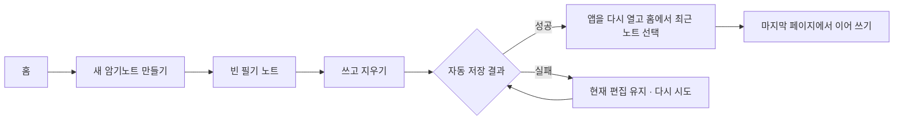
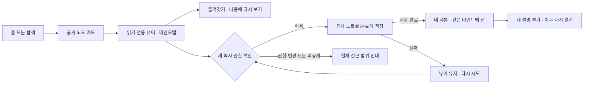

# Me-mento UX 스토리보드

문서 v1.1 · 2026-11-26 · 제품 V0 편집기 검증과 V1 사용자 흐름

[제품 기획서](product-plan.md) · [구현 명세서](implementation-spec.md) · [출범 계획서](project-kickoff.md) · [개발 로드맵](development-roadmap.md) · [문서 목록과 개정 이력](README.md)

이 문서는 두 장면에서 사용자가 **무엇을 보며, 무엇을 할 수 있고, 그 결과를 어떻게 알아차리는지**를 정의한다. 화면 배치와 안내 문구는 초안이다. 공개 범위, 저장·복사 완료 조건, 권한 처리는 연결된 제품 기획서와 구현 명세서를 따른다.

| 흐름 | 사용자가 이루려는 일 | 검증 시점 |
|---|---|---|
| UX-01 · 필기하고 다시 열기 | 방금 쓴 내용을 잃지 않고, 마지막 페이지에서 이어 쓴다. | V0(M1~M2)의 첫 화면은 편집기다. V1(M3)에서 홈과 최근 노트 경로를 연결한다. |
| UX-02 · 공개 노트를 복사해 공부하기 | 참고할 자료를 찾고, 두 탭을 내 iPad로 가져와 내 말로 정리한 뒤 다시 본다. | V1의 M5 공유 파일럿에서 필기와 마인드맵이 함께 복사되는지 검증한다. |

## UX-01 · 필기하고 다시 열기

아래 흐름도는 V1의 홈을 포함한다. V0 실험에서는 앱을 열면 한 페이지 편집기로 바로 들어가며, 쓰기·지우기·저장·재실행 장면을 같은 기준으로 검증한다.

### 사용자 흐름

### 장면별 스토리보드

**상황** · 수험생이 정보처리기사 공부를 하다가 ‘정규화’를 자기 말로 적어두려 한다. Pencil로 적고 한 구절을 지운 뒤, 다음 공부 시간에 같은 노트를 다시 찾는다. 이미 첫 로그인을 마친 상태다.

| 장면 | 사용자 행동과 예상 | 화면과 앱의 반응 | 검토 기준 |
|---|---|---|---|
| 01. 홈에서 시작 | 새 노트에 바로 쓰고 싶어 `새 암기노트 만들기`를 누른다. | 빈 필기, 마인드맵, PDF·워드 가져오기 선택을 보여준다. `빈 필기 노트`를 고르면 필기 탭과 첫 페이지가 열린다. | 사용자가 필기 시작점을 찾는다. 선택을 닫기만 하면 빈 노트가 생기지 않는다. |
| 02. 쓰고 지운다 | Pencil로 쓰고, 틀린 구절은 지우개로 지운다. 손가락으로 화면을 옮긴다. | 캔버스가 중심이고, 도구 막대에서 펜·지우개 중 어느 도구가 선택됐는지 보인다. Pencil 전용이 기본이다. 손가락 필기를 켜면 한 손가락으로 쓰거나 지우고 두 손가락으로 이동·확대한다. | 필기 도구와 입력 모드를 이해한다. 손바닥이나 화면 이동으로 의도하지 않은 획이 생기지 않는다. |
| 03. 필기를 마친다 | 별도 저장 동작 없이 잠시 화면을 떠난다. | 앱이 완료한 편집을 자동 저장한다. 저장 중과 실패를 구별하고, 실제 기록이 끝났을 때만 저장 완료로 표시한다. | 방금 쓴 획과 지운 결과를 어디까지 저장했는지 이해한다. |
| 04. 다시 열어 이어 쓴다 | 앱을 다시 열고 홈의 최근 노트에서 방금 작업한 노트를 누른다. | 마지막으로 보던 필기 페이지와 저장된 변경을 복원한다. 필기 도구를 바로 쓸 수 있다. | 추가한 획은 남고, 지운 구절은 다시 나타나지 않는다. 같은 페이지에서 바로 새 획을 쓸 수 있다. |

### 먼저 그려볼 편집기 상태

| 상태 | 화면 표현 초안 | 사용자의 다음 행동 |
|---|---|---|
| 정상 편집과 저장 중 | 상단에 노트 제목과 현재 탭. 캔버스 위 도구 막대에 선택된 도구와 손가락 입력 상태. 저장 중에는 캔버스를 가리지 않는 곳에 `저장 중…`. | 계속 편집할 수 있다. |
| 저장 실패 | 편집한 화면을 유지한다. `아직 저장하지 못했어요. 지금 편집 화면에서 다시 시도할 수 있어요.`와 `다시 시도`를 표시한다. | 실패한 편집을 다시 저장한다. 성공 전에는 그 편집이 다음 실행에 복원된다고 안내하지 않는다. |
| 다시 열림 | 마지막으로 저장한 페이지와 내용을 보여준다. 필기 도구는 화면에서 바로 찾을 수 있다. | 따로 복원 버튼을 누르지 않고 이어 쓴다. |

저장 완료 표시는 필요할 때 확인할 수 있는 작은 상태로 제안한다. 반복적인 성공 알림은 피하고, 실패와 재시도를 알아보기 쉽게 둔다. 처음 그릴 화면은 위 편집기 상태 세 가지와 이를 여는 홈의 최근 노트 카드다.

**명세 연결** · NAV-01, NOTE-01, INK-01, INK-02 · [인수 시나리오 V-04~V-07](implementation-spec.md#9-인수-테스트)

## UX-02 · 공개 노트를 복사해 공부하기

### 사용자 흐름

### 장면별 스토리보드

**상황** · 수험생이 필기노트를 정리하다가 자신이 건너뛴 내용이 궁금해진다. 탐색에서 다른 사람이 정리한 ‘데이터베이스’ 노트를 발견하고, 마인드맵의 ‘정규화’ 가지에 자기 설명을 보태고 싶다.

| 장면 | 사용자 행동과 예상 | 화면과 앱의 반응 | 검토 기준 |
|---|---|---|---|
| 01. 자료를 찾는다 | 홈의 최신 노트를 둘러보거나 탐색에서 제목·태그·소개로 검색한다. | 카드에 제목, 작성자, 태그, `복사 가능` 또는 `열람 전용`을 표시한다. | 열기 전에 주제와 복사 가능 여부를 안다. |
| 02. 마인드맵을 둘러본다 | 공개 노트를 열고 마인드맵 탭으로 전환한다. | 읽기 전용 노드, 작성자와 출처를 보여준다. 두 권한 모두 즐겨찾기할 수 있다. `내 노트에 복사`는 복사 가능 상태에서 제공한다. | 공개본과 내 노트를 구별하고, 즐겨찾기만으로는 편집용 사본이 생기지 않는다는 점을 이해한다. |
| 03. 전체를 가져온다 | 마인드맵을 보던 상태에서 `내 노트에 복사`를 누른다. | 필기·마인드맵을 함께 가져온다는 점을 버튼 주변에서 알 수 있다. `노트를 복사하는 중…`을 표시하고 빠른 중복 탭을 한 번의 작업으로 처리한다. | 마인드맵 탭에서 눌러도 두 탭이 함께 복사된다는 점을 이해한다. |
| 04. 같은 탭에서 내 설명을 보탠다 | 가져온 노드의 이름을 바꾸고, 필기 탭에서 메모를 덧붙인다. | 기기에 저장을 마치면 같은 마인드맵 탭의 사본 편집기를 연다. 편집 도구와 사본의 출처를 표시한다. | 사용자가 자기 사본에 들어왔다는 점을 바로 알아차린다. 공개 원본의 내용은 유지된다. |
| 05. 며칠 뒤 다시 연다 | iPad의 `내 노트`에서 사본을 열어 바꾼 설명을 복습한다. | 사본은 오프라인에서도 열리고 두 탭의 저장된 내용이 보인다. 원본의 권한 변경이나 일반 비공개 전환 이후에도 저장한 사본을 열 수 있다. | 자신이 덧붙인 설명을 찾고 이어서 편집할 수 있다. |

### 복사 버튼 주변에서 풀어야 할 예외

| 상황 | 안내 문구 초안과 화면 동작 |
|---|---|
| 처음부터 열람 전용 | `이 노트는 열람만 할 수 있어요.`를 권한 표시와 함께 둔다. 열람과 즐겨찾기를 계속 제공한다. |
| 뷰어를 열어둔 사이 열람 전용으로 바뀜 | `작성자가 이 노트를 열람 전용으로 바꿨어요.`를 표시한다. 새 사본을 만들지 않고 현재 권한으로 뷰어를 갱신한다. |
| 비공개 전환이나 운영 조치로 접근 중단 | `현재 이 노트를 열 수 없어요.`를 표시하고 탐색 또는 즐겨찾기로 돌아갈 수 있게 한다. 기존 로컬 사본은 내 노트에서 계속 열 수 있다. |
| 보던 버전보다 최신 공개본이 있음 | `새 공개본이 있어요.`와 최신 버전을 여는 행동을 제시한다. 새로 표시된 내용과 권한을 본 사용자가 복사를 진행한다. |
| 네트워크 또는 기기 저장 실패 | `복사를 완료하지 못했어요.`와 가능한 경우 `다시 시도`를 표시한다. 완성되지 않은 사본을 목록에 노출하지 않는다. |
| 기기 저장 완료, 서버 집계 확인 지연 | 기기에 사본 저장을 마쳤으므로 편집기를 연다. 작성자용 복사 수 집계의 재시도는 사본 편집을 막지 않는다. |

**화면 배치 초안** · 공개 뷰어의 노트 정보 영역에 작성자, 출처, 권한, 복사 행동을 둔다. 복사 뒤에는 같은 탭과 노트 제목을 유지하고, 편집 도구와 출처를 통해 현재 열려 있는 문서가 사본임을 드러낸다. 별도 성공 화면을 거치지 않는 흐름으로 검토한다.

**명세 연결** · FIND-01, FIND-02, PUB-02, COPY-01, LINE-01 · [인수 시나리오 V-10~V-16](implementation-spec.md#9-인수-테스트)

## 사용성 검토

| 관찰 과제 | 진행자가 볼 행동 | 다시 검토할 신호 |
|---|---|---|
| “정규화에 대한 설명을 쓰고, 한 구절을 지운 다음 앱을 다시 열어 이어 써보세요.” | 홈에서 노트를 열고 어떤 부분을 썼고 지웠는지 기억하며 같은 위치에서 쓰기 시작한다. | 저장 버튼을 찾거나, 마지막 페이지를 다시 찾느라 헤매거나, 지운 결과의 복원을 확신하지 못한다. |
| 저장 실패 화면을 보여주고 “지금 어떤 일이 일어났고, 다음에 무엇을 하시겠어요?”라고 묻는다. | 현재 화면의 필기가 남았다는 점과 디스크에 저장을 다시 시도해야 한다는 점을 말한다. | 이미 저장됐다고 믿고 앱을 닫으려 하거나 복구 행동을 찾지 못한다. |
| “다른 사람의 노트에서 정규화를 찾아 내 설명을 덧붙여 보세요.” | 제목·태그·소개에서 자료를 고르고, 사본을 만든 뒤 보고 있던 탭에서 노드를 편집한다. | 즐겨찾기로 편집이 되길 기대하거나, 복사 뒤 원본을 수정하는 것으로 오해한다. |
| 복사 시점에 권한이 바뀐 화면을 보여준다. | 현재 권한에서 가능한 일을 알아차리고, 새 사본이 생기지 않았음을 이해한다. | 이유를 알 수 없어 반복해서 누르거나 이전에 복사한 사본도 사라졌다고 생각한다. |

정상 흐름을 먼저 검토하고, 저장 실패와 권한 변경은 별도 장면으로 보여준다. 기록에는 관찰한 행동과 막힌 지점을 남긴다. 참가자는 예시 노트를 사용할 수 있으며, 결과 기록에 개인 필기 원문을 적을 필요는 없다.
